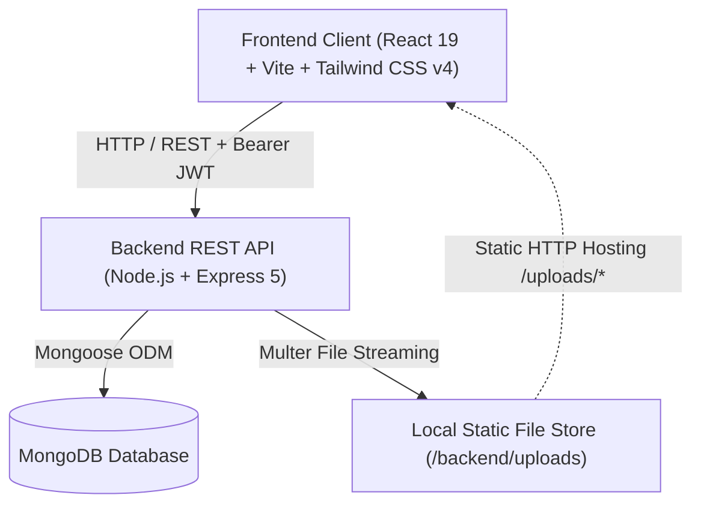
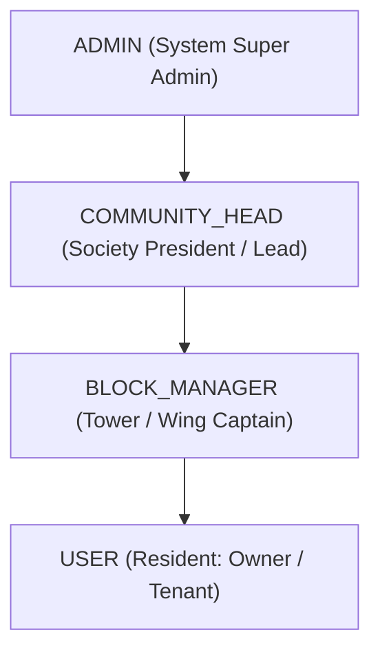
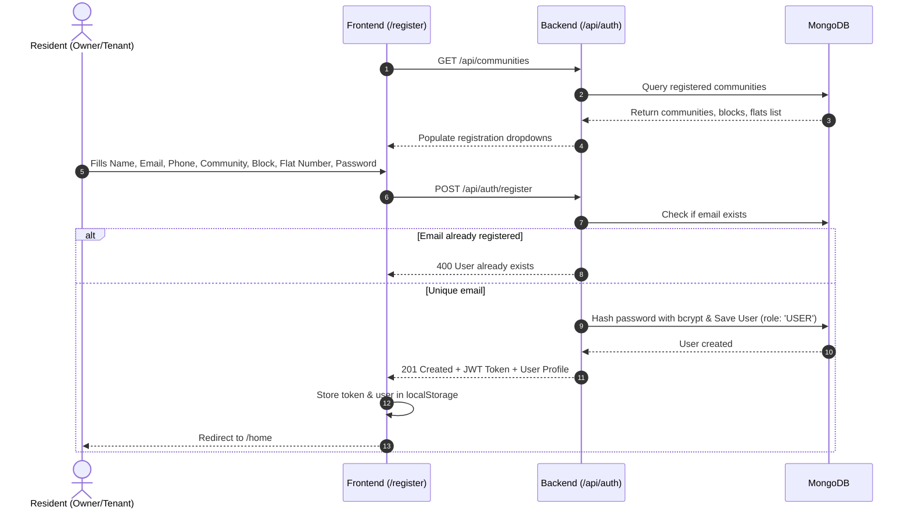
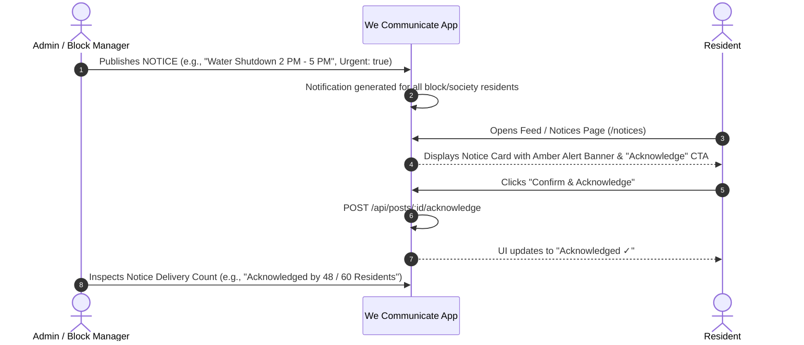
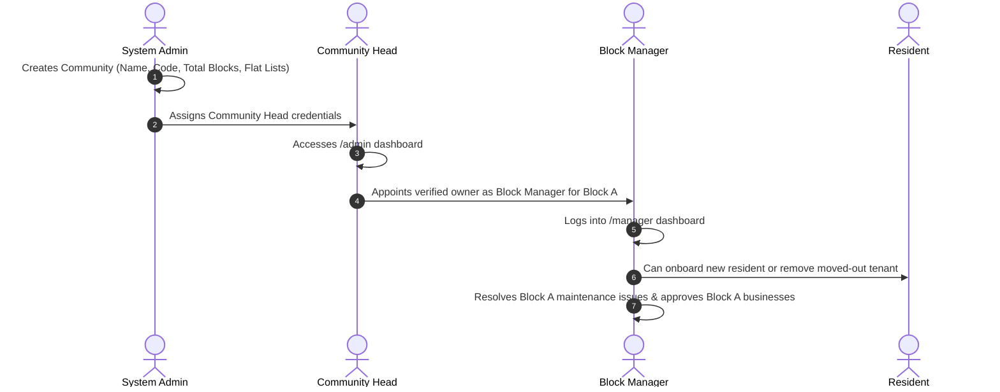
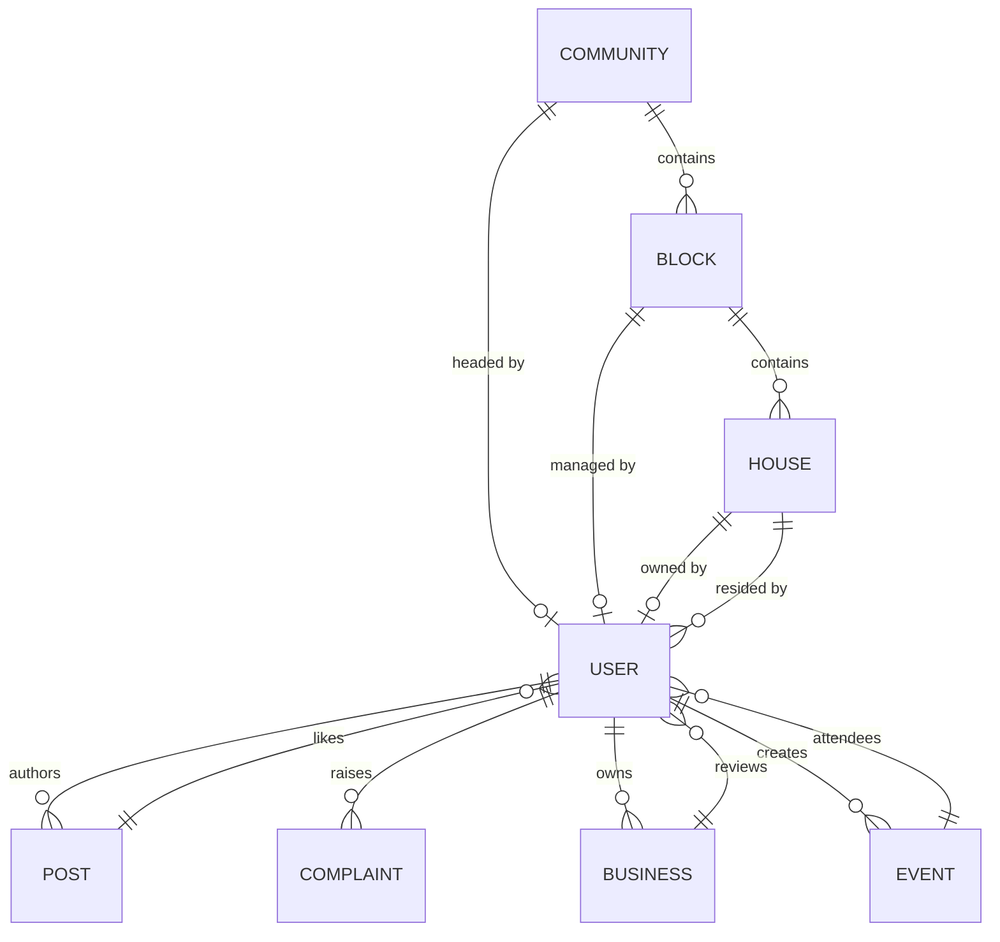

# We Communicate — Comprehensive System Documentation & Workflow Guide

> **Platform:** We Communicate  
> **Tagline:** *A stronger community, together. Built for better neighbourhoods.*  
> **Tech Stack:** React 19, Vite, Tailwind CSS v4, Framer Motion, Lucide Icons, Express 5, Node.js, MongoDB / Mongoose, JWT.

---

## 1. Executive Summary & Purpose

**We Communicate** is a centralized residential community management and neighborhood communication platform. Designed for residential apartment towers, housing societies, and gated communities, it replaces fragmented WhatsApp groups, paper noticeboards, and manual complaint registers with a secure, role-governed digital ecosystem.

### Core Objectives
1. **Streamlined Society Governance:** Hierarchical governance spanning Super Admins, Community Heads (RWA Presidents), Block Managers (Tower Captains), and Residents.
2. **Reliable Communication:** Official announcements, emergency notices with urgent badges, and verifiable delivery confirmation via resident acknowledgements.
3. **Structured Maintenance & Helpdesk:** Digital complaint ticketing with unique tracking IDs (`CMP-XXXX`), category classifications, handler assignment, and transparent resolution status timelines.
4. **Hyper-Local Commerce & Services:** A resident showcase for home entrepreneurs (bakers, tutors, tailors, fitness instructors, artists) with committee verification and peer reviews.
5. **Community Engagement:** Event calendars with interactive RSVPs, community discussion feeds, and neighborhood resident directories.
6. **Archived Governance Records:** A searchable, category-filtered vault for society bylaws, AGM minutes, committee handover logs, and financial audits.

---

## 2. System Architecture & Tech Stack



### Technology Breakdown

| Layer | Technologies / Packages | Purpose |
|---|---|---|
| **Frontend Framework** | React 19, Vite 8, React Router DOM 7 | Ultra-responsive SPA client rendering with lazy-loaded route splitting |
| **Frontend Styling** | Tailwind CSS 4, Framer Motion, Lucide Icons | Design system, layout animations, modal transitions, and iconography |
| **HTTP & State** | Axios (configured with interceptors), React Context API | `AuthContext` for credentials/roles, `NotificationContext` for live alerts |
| **Backend Runtime** | Node.js, Express 5 | RESTful API server, routing, and middleware processing |
| **Database & ODM** | MongoDB, Mongoose 9 | NoSQL persistence with schemas, relation population, and indexing |
| **Security & Auth** | JSON Web Tokens (`jsonwebtoken`), `bcryptjs`, Cookie Parser | JWT bearer authentication, salt hashing (10 rounds), route role guard |
| **File Handling** | Multer | Multi-file and single-file multipart uploads (avatars, posters, receipts) |

---

## 3. User Roles & Permission Matrix

The platform implements a **4-tier Role-Based Access Control (RBAC)** architecture:



| Feature / Action | `ADMIN` | `COMMUNITY_HEAD` | `BLOCK_MANAGER` | `USER` (Resident) |
|---|:---:|:---:|:---:|:---:|
| **Create & Delete Communities** | Yes | No | No | No |
| **Assign Community Heads** | Yes | No | No | No |
| **Appoint / Create Block Managers** | Yes | Yes | No | No |
| **Add / Delete Residents in Block** | Yes | Yes | Yes (Their Block) | No |
| **View Community Resident Directory** | Yes | Yes | Yes (Their Block) | Yes (Explore Tab) |
| **Publish Official Notices** | Yes | Yes | Yes | No |
| **Acknowledge Notices** | Yes | Yes | Yes | Yes |
| **Create Community Feed Posts** | Yes | Yes | Yes | Yes |
| **Delete / Pin Posts** | Any Post | Any in Society | Any in Block | Own Posts Only |
| **Raise Maintenance Complaint** | Yes | Yes | Yes | Yes |
| **Update Complaint Status / Notes** | Yes | Yes | Yes (Their Block) | No |
| **Approve Resident Businesses** | Yes | Yes | Yes | No |
| **Submit / Manage Own Business** | Yes | Yes | Yes | Yes |
| **Review & Rate Businesses** | Yes | Yes | Yes | Yes |
| **Create & Manage Events** | Yes | Yes | Yes | Yes |
| **RSVP to Events** | Yes | Yes | Yes | Yes |
| **Upload Society Bylaws & Records** | Yes | Yes | Yes | No |
| **Download / View Bylaws & Records**| Yes | Yes | Yes | Yes |

---

## 4. End-to-End System Workflows

### 4.1. Resident Registration & Community Onboarding Workflow



---

### 4.2. Maintenance & Complaint Ticket Resolution Lifecycle

```mermaid
stateDiagram-v2
    [*] --> PENDING: Resident raises ticket via App or Desk
    PENDING --> IN_PROGRESS: Block Manager / Admin assigns technician & starts work
    IN_PROGRESS --> RESOLVED: Technician finishes repair; Manager logs resolution notes & timestamp
    RESOLVED --> [*]

    note right of PENDING
        Ticket ID: CMP-XXXX
        Categorized: WATER, ELECTRICITY,
        LIFT, CLEANING, SECURITY, etc.
        Intake Route tracked.
    end note

    note right of IN_PROGRESS
        Handler name assigned
        (e.g., 'Ramesh - Plumber')
    end note

    note right of RESOLVED
        Status marked RESOLVED
        resolvedAt timestamp recorded
        Resolution notes visible to resident
    end note
```



#### Detailed Complaint Workflow:
1. **Intake:** Resident navigates to `/complaints` or clicks "Raise Complaint" on `/home`.
2. **Form Submission:** Specifies Category (`WATER`, `ELECTRICITY`, `LIFT`, `CLEANING`, `SECURITY`, `PARKING`, `MAINTENANCE`), Title, Flat Number, Description, Intake Route (`RESIDENT_APP`, `SECURITY_GUARD`, `OFFICE_REGISTER`, `PHONE_ESCALATION`), and an optional photo attachment.
3. **Dispatch:** The server generates a unique ticket ID (`CMP-####`).
4. **Scoping & Visibility:**
   - Standard Residents only see their own filed tickets.
   - Block Managers see tickets belonging to flats in their assigned block.
   - Admins see society-wide tickets.
5. **Status Update:** Managers update ticket status to `IN_PROGRESS` or `RESOLVED`, adding resolution notes and assigned technician names.

---

### 4.3. Notice Delivery & Acknowledgement Workflow



---

### 4.4. Resident Home Business Onboarding & Review Workflow

```mermaid
sequenceDiagram
    autonumber
    actor Entrepreneur as Resident Business Owner
    participant API as Backend (/api/businesses)
    actor Manager as Block Manager / Admin
    actor Customer as Neighbor Resident

    Entrepreneur->>API: POST /api/businesses (Name, Category, Services/Prices, Phone, Timings, Photos)
    API->>API: Status set to 'PENDING'
    Manager->>API: Reviews business submission in Governance Desk
    Manager->>API: PUT /api/businesses/:id/approve
    API->>API: Status updated to 'ACTIVE'
    Customer->>API: Browses /businesses or /explore
    Customer->>Customer: Contacts business via direct Phone / WhatsApp CTA
    Customer->>API: POST /api/businesses/:id/reviews (Rating: 1-5, Comment)
    API->>API: Review appended to business profile; Average star rating recalculated
```

---

### 4.5. Society Governance & Hierarchical Management Workflow



---

## 5. Comprehensive Feature Catalog

### 5.1. Authentication, Identity & Profiles
- **Community-Aware Registration:** Dynamic retrieval of registered communities with cascaded loading of block names and flat numbers.
- **Resident Types:** Distinct differentiation between `OWNER` and `TENANT`.
- **JWT Session Security:** Tokens stored securely and validated on all authenticated endpoints.
- **Profile Hub:** Residents can view personal activity tabs (My Posts, My Complaints, My Businesses, RSVPed Events), update contact numbers, and upload profile pictures.
- **Instant Role Switcher:** In-browser testing switcher (`AuthContext.switchRole`) allowing immediate verification of resident, manager, and admin viewpoints.

### 5.2. Community Feed & Noticeboard
- **Multi-Type Posts:** Categorized as `NOTICE`, `EVENT`, `BUSINESS`, or `GENERAL`.
- **Urgent Broadcasts:** Visual high-priority styling for urgent announcements.
- **Pin to Top:** Admins and managers can pin critical announcements to the top of the feed.
- **Notice Acknowledgement:** "I acknowledge" tracking allowing management to see which residents have read critical updates.
- **Social Interactivity:** Upvoting / liking, threaded comments, and comment deletion permissions.
- **Visual Content:** Supports drag-and-drop file uploads or selectable high-resolution stock photography presets.

### 5.3. Maintenance & Complaints Management
- **Automated Ticket IDs:** Generates human-friendly ticket identifiers (`CMP-1042`).
- **Comprehensive Categories:** Water, Electricity, Lift, Cleaning, Security, Parking, Maintenance, Other.
- **Intake Channel Auditing:** Identifies whether an issue originated via the resident mobile app, security guard intercom, office register, or phone escalation.
- **Live Status Timelines:** Interactive modal showing visual progression: `PENDING` ➔ `IN_PROGRESS` ➔ `RESOLVED`.
- **Resolution Auditing:** Records the exact timestamp of resolution and allows managers to record detailed resolution notes and the name of the assigned technician.

### 5.4. Resident Business Directory & Marketplace
- **Home Business Categories:** Home Bakers, Tutors & Coaching, Tailors & Fashion, Beauty & Grooming, Fitness Trainers, Artists & Crafts, Food & Catering.
- **Detailed Menus & Services:** Structured catalog of services with individual price lists.
- **Approval Pipeline:** Admin / Block Manager approval gate prevents spam or unauthorized commercial operations.
- **Status Controls:** Owners and managers can pause, resume, or close business listings.
- **Community Reviews:** Verified resident reviews with 1 to 5 star ratings and timestamped feedback.
- **Direct Engagement:** One-click calling and WhatsApp integration.

### 5.5. Community Events & Gatherings
- **Event Scheduling:** Title, description, date, time, venue, and banner upload.
- **One-Click RSVP:** Interactive RSVP mechanism with live attendee counts.
- **Live Polling Synchronization:** Built-in polling hook (`useEventPolling`) keeps attendee numbers and event changes synchronized across all open browser windows.

### 5.6. Official Records, Bylaws & AGM Minutes
- **Digital Document Vault:** Safe repository for official documents.
- **Categorization:**
  - `BYLAWS`: Society bylaws, house rules, pet policies.
  - `AGM_MINUTES`: Annual General Body Meeting and committee minutes.
  - `COMMITTEE_HANDOVER`: Formal handover logs between outgoing and incoming management committees.
  - `FINANCIAL_AUDIT`: Annual financial statements, balance sheets, and audit reports.
  - `VENDOR_CONTRACT`: Lift maintenance (AMC), security agency, and generator service contracts.
  - `SOCIETY_RESOLUTION`: Passed executive committee resolutions.
- **Reference Tracking:** Automated reference numbering (`DOC-BYL-XXX`).

### 5.7. Governance Dashboards
- **Admin Dashboard (`/admin`):**
  - High-level KPI metrics (Total Communities, Residents, Blocks, Open Complaints, Pending Businesses).
  - Community Creator with block and flat generator.
  - Community Head provisioner.
  - Global resident directory with role elevation and user deletion.
  - Cross-society business moderation.
- **Block Manager Dashboard (`/manager`):**
  - Block-specific resident roster management.
  - Onboard new residents directly into specific flats.
  - Block-scoped maintenance dispatch and status progression.

---

## 6. Database Models & Schema Specifications



### Key Models Overview:
1. **`User`:** `name`, `email`, `password`, `phone`, `community`, `houseNumber`, `role` (`ADMIN`, `COMMUNITY_HEAD`, `BLOCK_MANAGER`, `USER`), `residentType` (`OWNER`, `TENANT`), `house`, `block`, `profileImage`.
2. **`Community`:** `name`, `location`, `code`, `totalBlocks`, `totalFlats`, `managerName`, `communityHead` (ref: User), `blocksList` (array of strings), `flatsList` (array of strings).
3. **`Block`:** `name`, `blockNumber`, `community`, `manager` (ref: User), `totalHouses`, `description`.
4. **`House`:** `houseNumber`, `block` (ref: Block), `owner` (ref: User), `residents` (array of ref: User), `status` (`OWNER_OCCUPIED`, `TENANT_OCCUPIED`, `VACANT`).
5. **`Post`:** `author` (ref: User), `type` (`GENERAL`, `NOTICE`, `EVENT`, `BUSINESS`), `title`, `description`, `image`, `likes` (array of ref: User), `comments` (array with user ref, text, date), `block` (ref: Block), `isPinned`, `isUrgent`, `acknowledgements` (array with user ref, acknowledgedAt).
6. **`Complaint`:** `ticketId`, `raisedBy` (ref: User), `block` (ref: Block), `house` (ref: House), `flatNumber`, `intakeRoute`, `title`, `description`, `category` (`WATER`, `ELECTRICITY`, `LIFT`, `CLEANING`, `SECURITY`, `PARKING`, `MAINTENANCE`, `OTHER`), `image`, `status` (`PENDING`, `IN_PROGRESS`, `RESOLVED`), `assignedHandlerName`, `assignedTo` (ref: User), `resolutionNotes`, `resolvedAt`.
7. **`Business`:** `owner` (ref: User), `businessName`, `category` (`TAILORING`, `TUITION`, `BAKING`, `BEAUTY`, `FITNESS`, `ART`, `FOOD`, `OTHER`), `description`, `images`, `services` (name, price), `contact`, `timings`, `status` (`PENDING`, `ACTIVE`, `PAUSED`, `CLOSED`), `approvedBy` (ref: User), `reviews` (author, rating 1-5, comment, date).
8. **`Event`:** `createdBy` (ref: User), `title`, `description`, `poster`, `date`, `time`, `venue`, `community`, `block` (ref: Block), `attendees` (array of ref: User).
9. **`Record`:** `title`, `category` (`BYLAWS`, `AGM_MINUTES`, `COMMITTEE_HANDOVER`, `FINANCIAL_AUDIT`, `VENDOR_CONTRACT`, `SOCIETY_RESOLUTION`), `description`, `documentUrl`, `referenceCode`, `effectiveDate`, `uploadedBy` (ref: User), `community`.
10. **`Notification`:** `recipient` (ref: User), `type` (`NEW_BUSINESS`, `NEW_NOTICE`, `COMPLAINT_UPDATE`, `EVENT`, `GENERAL`), `title`, `message`, `relatedId`, `isRead`.

---

## 7. API Route Endpoints Reference

### Authentication (`/api/auth`)
- `POST /register` — Register a new resident account
- `POST /login` — Authenticate credentials, auto-seed admin if matching admin credentials, return JWT
- `POST /logout` — Invalidate session
- `GET /me` — Fetch current authenticated user with populated block and house details

### Communities & Governance (`/api/communities`)
- `GET /` — List all registered societies (public for registration dropdown)
- `POST /` — Create a new society with blocks and flat lists (`ADMIN` only)
- `DELETE /:id` — Delete a society (`ADMIN` only)
- `GET /:id/details` — Detailed breakdown: Community Head, Blocks, and full Resident roster (`ADMIN`, `COMMUNITY_HEAD`)
- `POST /:id/assign-head` — Assign an existing resident or create credentials for Community Head (`ADMIN` only)
- `POST /:id/assign-block-manager` — Elevate an owner resident to Block Manager (`COMMUNITY_HEAD`, `ADMIN`)
- `POST /:id/create-block-manager` — Create dedicated Block Manager credentials (`ADMIN`, `COMMUNITY_HEAD`)

### Posts & Noticeboard (`/api/posts`)
- `GET /` — Retrieve sorted post feed (pinned posts first)
- `POST /` — Create a post (supports multipart image upload)
- `GET /:id` — Get single post details
- `PUT /:id` — Edit an existing post
- `DELETE /:id` — Delete a post (author or admin)
- `DELETE /mine` — Bulk delete all posts authored by current user
- `PATCH /:id/pin` — Toggle pin/unpin status (`ADMIN` or author)
- `POST /:id/acknowledge` — Toggle delivery acknowledgement on notices
- `POST /:id/like` — Toggle like/upvote
- `POST /:id/comment` — Post a comment
- `DELETE /:id/comment/:commentId` — Delete a comment (comment author, post author, or admin)

### Maintenance & Complaints (`/api/complaints`)
- `GET /` — List complaints (Residents see their own, Block Managers see their block, Admins see all)
- `POST /` — Create a maintenance ticket (auto-assigns `CMP-XXXX`)
- `GET /:id` — Get single complaint ticket with timeline
- `PUT /:id/status` — Update status (`PENDING` ➔ `IN_PROGRESS` ➔ `RESOLVED`), record handler name, resolution notes
- `PUT /:id/assign` — Assign ticket to a specific user
- `DELETE /:id` — Delete a complaint ticket (`ADMIN` only)

### Resident Businesses (`/api/businesses`)
- `GET /` — List all approved and active resident businesses
- `POST /` — Submit a business profile for approval (multipart photos)
- `GET /:id` — View detailed business profile, services list, reviews
- `PUT /:id/approve` — Approve business listing (`ADMIN`, `BLOCK_MANAGER`)
- `PUT /:id/pause` — Pause business operations
- `PUT /:id/resume` — Resume business operations
- `PUT /:id/close` — Mark business as permanently closed
- `POST /:id/reviews` — Add a verified resident review & 1-5 rating
- `DELETE /:id` — Delete business listing (owner only)

### Community Events (`/api/events`)
- `GET /` — List upcoming community and block events
- `POST /` — Create a new community event
- `GET /:id` — View event details and attendee list
- `POST /:id/rsvp` — Toggle attendance RSVP (records attendee User ID)
- `DELETE /:id` — Cancel or delete an event

### Official Records & Bylaws (`/api/records`)
- `GET /?category=...` — Filter and view society bylaws, minutes, audits
- `POST /` — Upload or archive a society document (`ADMIN`, `BLOCK_MANAGER`)
- `DELETE /:id` — Remove an archived document

### Notifications (`/api/notifications`)
- `GET /` — Fetch notifications for authenticated user
- `PUT /:id/read` — Mark single notification as read
- `PUT /read-all` — Mark all user notifications as read
- `DELETE /:id` — Dismiss/delete notification

---

## 8. Deployment & Environment Setup

### Environment Variables

#### Backend (`backend/.env`)
```env
PORT=5000
MONGO_URI=mongodb://127.0.0.1:27017/we_communicate
JWT_SECRET=super_secret_jwt_key_we_communicate_2026
URL_frontend=http://localhost:5173
```

#### Frontend (`frontend/.env`)
```env
VITE_API_URL=http://localhost:5000/api
```

### Running the System Locally

1. **Start MongoDB:** Ensure MongoDB is running locally on port `27017` (or provide a remote MongoDB Atlas URI in `backend/.env`).
2. **Seed Initial Admin:**
   ```bash
   cd backend
   npm run seed
   ```
   *Default Admin:* `admin@gmail.com` | *Password:* `1234567890`
3. **Start Backend Server:**
   ```bash
   cd backend
   npm run dev
   # Runs on http://localhost:5000
   ```
4. **Start Frontend Client:**
   ```bash
   cd frontend
   npm run dev
   # Runs on http://localhost:5173
   ```
