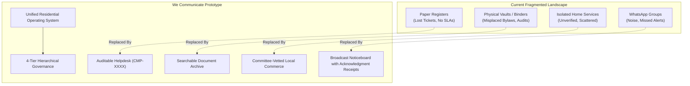
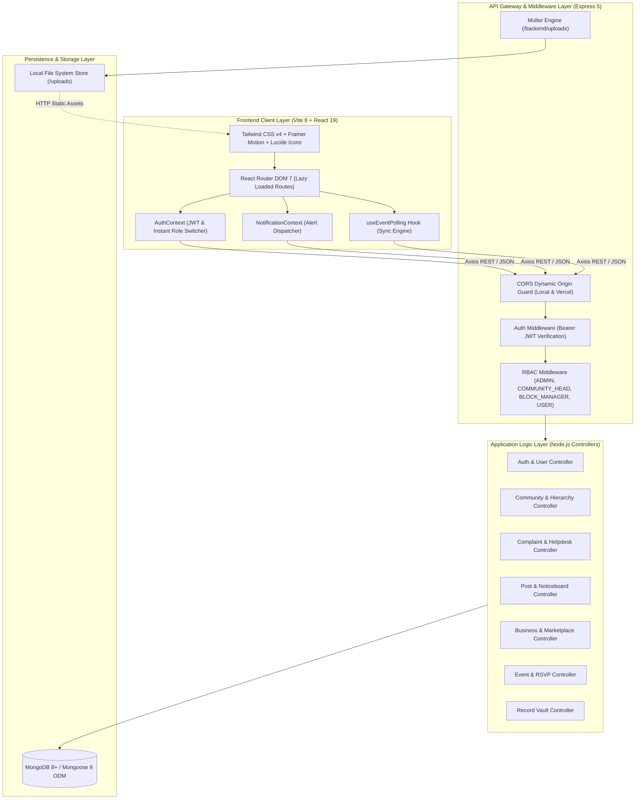
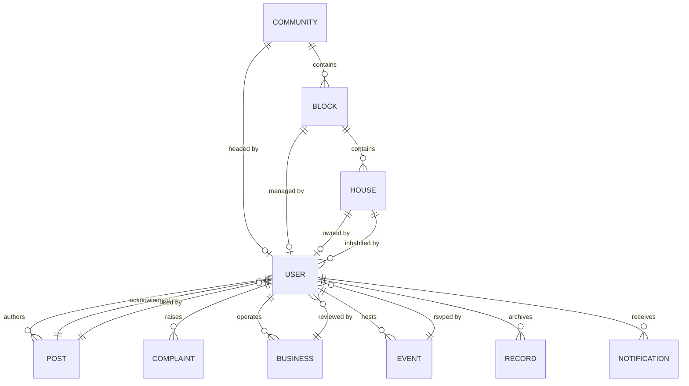
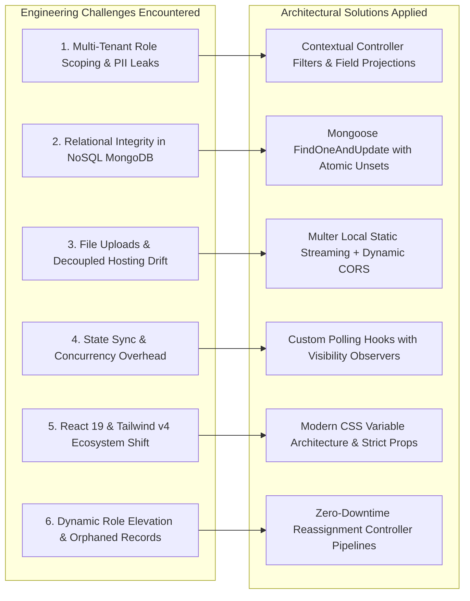
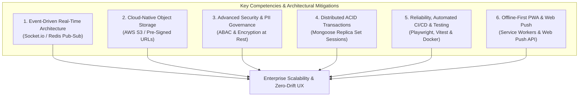
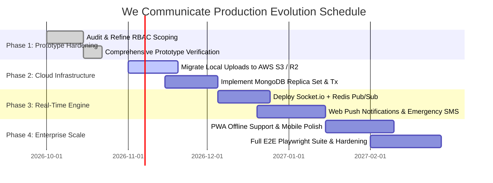

# PROJECT PROPOSAL & TECHNICAL ARCHITECTURE REPORT
## We Communicate: Hyper-Local Residential Governance & Neighborhood Management Platform

> **Document Type:** System Proposal, Prototype Engineering Report & Architectural Roadmap  
> **Target Platform:** We Communicate (*Built for modern residential towers, gated societies, and housing communities*)  
> **Status:** Prototype Implemented & Verified / Architectural Enhancement Stage  
> **Author:** System Architecture & Engineering Team  
> **Current Tech Stack:** React 19, Vite 8, Tailwind CSS v4, Express 5, Node.js, MongoDB / Mongoose 9, JWT, Multer  

---

## 1. Executive Summary & Prototype Proposal

### 1.1 Project Genesis & Background
Modern urban living has increasingly transitioned toward high-density apartment complexes, gated housing societies, and cooperative housing societies (RWAs). Despite physical proximity, residential communication and society administration remain severely fragmented:
- **Noise & Information Loss in Chat Apps:** Society WhatsApp groups become overwhelmed with unmoderated noise, greetings, and side chatter, causing critical operational alerts (e.g., water shutdowns, power maintenance, security incidents) to be lost.
- **Opacity in Maintenance & Ticketing:** Maintenance issues are recorded in physical paper registers at guard shacks or reported informally via phone calls, offering zero visibility into resolution SLAs, handler assignment, or historical accountability.
- **Unverified & Scattered Home Businesses:** Home bakers, tutors, tailors, fitness trainers, and freelance professionals operating within apartment blocks lack a trusted, committee-approved hyper-local marketplace.
- **Administrative Friction & Lost Institutional Memory:** Managing committee turnover leads to lost AGM minutes, misplaced AMC vendor contracts, and disputed bylaws because records reside on personal laptops or physical binders.

### 1.2 The Proposal: Prototype Concept & Scope
The **We Communicate** prototype was conceived as a unified, role-governed **Residential Operating System** that bridges the communication chasm between Residents, Wing/Block Managers, and Managing Committees. 

The prototype's mandate is to establish a **multi-tiered, secure, and auditable digital ecosystem** that solves four foundational pillars:
1. **Verifiable Governance:** Hierarchical administration from System Admins down to Community Heads (RWA Presidents) and Block Managers (Tower Captains).
2. **Accountable Operations:** Digital helpdesk ticketing with automated tracking codes (`CMP-XXXX`), intake route tracking, handler assignment, and visible resolution timelines.
3. **Audited Communications:** Official society noticeboard featuring urgent alert broadcasting and **"I Acknowledge" delivery receipts**, verifying that residents actually read critical bulletins.
4. **Hyper-Local Commerce & Social Cohesion:** A verified home business directory with peer reviews, an event planning hub with real-time RSVP tracking, and a secure document archive.



---

## 2. Core Idea, Product Philosophy & Personas

### 2.1 The Philosophy: Role-Scoped Governance
Unlike conventional generic social networks or monolithic management tools, **We Communicate** enforces strict hierarchical data scoping and role boundaries:
- **System Administrator (Global Platform Admin):** Creates societies, defines block/flat topologies, provisions initial Community Heads, and monitors global health metrics.
- **Community Head (RWA President / Society Secretary):** Governs their specific society, appoints verified residents as Block Managers, uploads statutory records, and moderates cross-tower affairs.
- **Block Manager (Tower / Wing Captain):** Superintends their assigned block/tower, onboards new residents, reviews block-level business listings, and directly dispatches maintenance staff.
- **Resident (Owner / Tenant):** Interacts with verified neighbors, raises maintenance tickets for their flat, reads and acknowledges notices, RSVPs to events, and lists/reviews home businesses.

### 2.2 Target Personas & Core Use Cases

| Persona | Typical Profile | Primary Frustrations | Value Realized in Prototype |
|---|---|---|---|
| **Resident (Owner)** | 35–65 y/o property owner | Poor visibility into society spend; maintenance complaints ignored; noisy WhatsApp groups | Direct ticket tracking with technician logging; authenticated AGM document access; clear notice acknowledgements |
| **Resident (Tenant)** | 22–35 y/o renter | Stigmatized as "second-class" residents; lack of neighborhood discovery; unaware of building rules | Self-service registration; access to approved local bakers/services; instant event RSVPs; digital bylaws access |
| **Block Manager** | Active resident volunteer managing Wing B | Swamped with repetitive calls; difficulty tracking which plumber went to which flat | Block-scoped dashboard; one-click technician assignment; verified resident roster management |
| **Community Head** | RWA Committee President / Secretary | Vendor disputes; missing historical records during committee handover; legal liability | Digital vault for AMC contracts and resolutions; automated resident count audit; broadcast urgent notice receipts |

---

## 3. High-Level System Architecture

### 3.1 Architecture Overview
The platform is designed around a decoupled, service-oriented client-server architecture utilizing the **MERN** stack (React 19 + Express 5 + Node.js + MongoDB):



### 3.2 Technical Stack Breakdown

| Component | Technology | Rationale & Advantage |
|---|---|---|
| **Client Core** | React 19, Vite 8 | Ultra-fast HMR, concurrent rendering capabilities, and zero-overhead bundle optimization. |
| **Client Routing & UI** | React Router DOM 7, Tailwind CSS 4, Framer Motion | Modern nested route code-splitting, custom aesthetic styling, and smooth layout animations. |
| **State & Networking** | Context API, Axios Interceptors | Lightweight global authentication, automatic Bearer JWT injection, and unified HTTP error handling. |
| **Backend Runtime** | Node.js 20+, Express 5 | High-throughput asynchronous event loop, modern Express 5 promise-based middleware error handling. |
| **Database & ODM** | MongoDB, Mongoose 9 | Flexible document model accommodating hierarchical relationships, schema validation, and dynamic population. |
| **Security & Cryptography**| `bcryptjs`, `jsonwebtoken` | 10-round salt hashing for credentials and signed JWT bearer tokens for stateless session management. |
| **Media Handling** | Multer | Multipart form-data handling for maintenance complaint photos, notice attachments, and business service photos. |

---

## 4. Entity-Relationship Data Model & Schema Specifications

The database schema is structured to maintain referential integrity across hierarchical administrative boundaries:



### 4.1 Key Schema Attributes

1. **`Community`:**
   - `name`, `code` (unique uppercase string, e.g., `GOH-01`), `location`, `totalBlocks`, `totalFlats`.
   - `communityHead`: Reference to `User` (assigned leader).
   - `blocksList`: Array of predefined tower identifiers (`['Block A', 'Block B']`).
   - `flatsList`: Array of pre-seeded unit identifiers (`['A-101', 'A-102', 'B-101']`).
2. **`Block`:**
   - `name`, `blockNumber`, `community` (name identifier), `manager` (Ref: `User`), `totalHouses`.
3. **`User`:**
   - `name`, `email` (unique index), `password` (bcrypt hash), `phone`, `community`, `houseNumber`.
   - `role`: Enum `['ADMIN', 'COMMUNITY_HEAD', 'BLOCK_MANAGER', 'USER']`.
   - `residentType`: Enum `['OWNER', 'TENANT']`.
   - `block` (Ref: `Block`), `house` (Ref: `House`), `profileImage`.
4. **`Complaint`:**
   - `ticketId`: Auto-generated alphanumeric format (`CMP-XXXX`).
   - `raisedBy` (Ref: `User`), `flatNumber`, `block` (Ref: `Block`), `house` (Ref: `House`).
   - `category`: Enum `['WATER', 'ELECTRICITY', 'LIFT', 'CLEANING', 'SECURITY', 'PARKING', 'MAINTENANCE', 'OTHER']`.
   - `intakeRoute`: Enum `['RESIDENT_APP', 'SECURITY_GUARD', 'OFFICE_REGISTER', 'PHONE_ESCALATION']`.
   - `status`: Enum `['PENDING', 'IN_PROGRESS', 'RESOLVED']`.
   - `assignedHandlerName`: Technician's name (e.g., `"Suresh - Master Plumber"`).
   - `resolutionNotes`: String documenting the fix applied; `resolvedAt`: Timestamp.
5. **`Post`:**
   - `author` (Ref: `User`), `type` Enum `['GENERAL', 'NOTICE', 'EVENT', 'BUSINESS']`.
   - `title`, `description`, `image`, `isPinned`, `isUrgent`.
   - `acknowledgements`: Array of subdocuments `{ user: Ref(User), acknowledgedAt: Date }`.
   - `likes`: Array of Ref(`User`), `comments`: Array of `{ user, text, createdAt }`.
6. **`Business`:**
   - `owner` (Ref: `User`), `businessName`, `category` (Baking, Coaching, Tailoring, etc.).
   - `services`: Array of `{ name, price }`.
   - `status`: Enum `['PENDING', 'ACTIVE', 'PAUSED', 'CLOSED']`.
   - `approvedBy`: Ref(`User`); `reviews`: Array of `{ author, rating, comment, date }`.
7. **`Record`:**
   - `title`, `category` (`BYLAWS`, `AGM_MINUTES`, `COMMITTEE_HANDOVER`, `FINANCIAL_AUDIT`, `VENDOR_CONTRACT`, `SOCIETY_RESOLUTION`).
   - `referenceCode`: Auto-indexed code (`DOC-BYL-001`), `documentUrl`, `effectiveDate`, `uploadedBy`.

---

## 5. Details of Actual Implementation

The prototype codebase consists of 7 end-to-end implemented modules covering both resident and governance personas:

### 5.1 Community-Aware Onboarding & Identity Provisioning
- **Cascading Dropdown Registration:** In `frontend/src/pages/Register.jsx`, selecting a community dynamically queries `/api/communities`, populating the registered blocks and flat numbers without manual typing errors.
- **Dynamic Role Promotion Without Re-Registration:** In `backend/controllers/communityController.js`, Community Heads can elevate an existing verified resident to `BLOCK_MANAGER` directly through a dropdown. The system automatically unseats the former manager, reassigns their role back to `USER`, and binds the new manager's ID to the corresponding `Block` document atomically.
- **In-Browser Role Switcher:** For comprehensive evaluation and QA, the `AuthContext` exposes an instant role switcher allowing immediate toggling between `ADMIN`, `COMMUNITY_HEAD`, `BLOCK_MANAGER`, and `USER` without clearing session caches.

### 5.2 Noticeboard & Verifiable Acknowledgement Engine
- **Urgent Broadcast Styling:** Critical alerts display high-visibility amber/red banners with alert icons.
- **Delivery Receipts Tracking:** Rather than assuming residents saw a post, notices render an interactive **"Confirm & Acknowledge"** button.
- **Audit Verification:** Clicking acknowledge invokes `POST /api/posts/:id/acknowledge`. The backend appends the user ID and timestamp to the post. Admins and managers view an acknowledgement counter (e.g., *"Acknowledged by 48 / 60 Residents"*), establishing legal and operational proof of delivery.

### 5.3 Maintenance & Complaint Helpdesk Engine
- **Lifecycle Progression:** Tickets transition through an explicit state machine:
  $$\text{PENDING} \longrightarrow \text{IN\_PROGRESS} \longrightarrow \text{RESOLVED}$$
- **Intake Channel Auditing:** Tickets record whether they were entered by the resident via the mobile app, reported at the security intercom, logged in the office physical register, or escalated by telephone.
- **Technician Attribution:** When a ticket is updated to `IN_PROGRESS` or `RESOLVED`, the system captures the assigned technician's name and specific resolution notes, visible directly on the resident's ticket timeline.

### 5.4 Hyper-Local Business Marketplace
- **Committee Approval Pipeline:** Prevents unauthorized commercial intrusions or spam. Businesses are submitted with service menus, pricing, and photos in `PENDING` state until approved by a Block Manager or Admin.
- **Verified Resident Reviews:** Only registered residents belonging to the same community can submit star ratings (1–5) and written feedback, ensuring authenticity and preventing fake ratings.
- **Direct Contact Integrations:** Cards include one-click WhatsApp and direct phone dialing CTAs.

### 5.5 Community Event Calendar & Polling Synchronization
- **One-Click RSVP:** Residents toggle RSVP status with immediate optimistic UI updates and server synchronization.
- **Cross-Tab/Window Polling (`useEventPolling`):** Implemented in `frontend/src/hooks/useEventPolling.js` to periodically fetch updated attendee lists and event modifications, ensuring multiple open resident sessions stay synchronized without manual browser refreshes.

### 5.6 Governance Records Vault
- **Classified Archival:** Official documents are categorized into Bylaws, AGM Minutes, Handover Logs, Financial Audits, Vendor Contracts, and Resolutions.
- **Reference Tracking:** Generates human-friendly reference identifiers (`DOC-BYL-001`) to support legal traceability during committee transitions.

### 5.7 Two-Tier Governance Desks
- **Global Admin Portal (`/admin`):** Cross-community aggregation, community provisioning, block/flat topology generation, Community Head assignments, and global user directory moderation.
- **Block Manager Desk (`/manager`):** Scoped strictly to the manager's assigned tower. Enables onboarding residents directly to specific flats, dispatching block maintenance tickets, and reviewing block-specific home businesses.

---

## 6. Challenges Faced in Implementation of the New System Architecture

During the transition from conceptual design to the implemented prototype, several complex architectural, infrastructural, and frontend engineering challenges were encountered and addressed:



### Challenge 1: Multi-Tier Role Scoping & Cross-Block Data Isolation
- **The Problem:** The system must enforce strict isolation boundaries: Block Managers must only see tickets and residents from their tower; Community Heads must only see their society; standard Residents must only see their own tickets. Early implementations risked overfetching or inadvertently exposing resident phone numbers across towers.
- **Resolution in Prototype:** Implemented dynamic query filtering within backend controllers based on `req.user.role`. For instance, `complaintController.js` inspects `req.user.role` to conditionally apply `{ raisedBy: req.user._id }` for residents, `{ block: req.user.block }` for Block Managers, and global queries for Admins.

### Challenge 2: Dynamic Role Elevation & Orphaned Entity Management
- **The Problem:** When appointing an existing resident as a Block Manager, the previous manager must be gracefully demoted back to a regular resident, and the new manager's role must update without requiring logout/re-registration or leaving dangling pointers in the `Block` document.
- **Resolution in Prototype:** Created an atomic assignment workflow in `communityController.js` (`assignBlockManager`). If a block already has an assigned manager, the system unsets their block association and resets their role to `USER` before promoting the new candidate and updating `block.manager` in a coordinated sequence.

### Challenge 3: Decoupled Deployment & Multipart Media Storage
- **The Problem:** The frontend is configured for deployment on Vercel (`vercel.json`), while the backend operates as a standalone Express service saving uploaded photos to `/backend/uploads`. Vercel serverless environments possess read-only ephemeral filesystems, creating CORS rejections and missing image paths when static files are requested across different hostnames.
- **Resolution in Prototype:** Configured a dynamic CORS middleware in `backend/server.js` matching `*.vercel.app` alongside local origins. Implemented explicit static streaming routes via `express.static(uploadsPath)` and structured image URLs with a centralized asset helper (`media.js`) to prepend API host prefixes dynamically.

### Challenge 4: Real-Time Synchronization vs. Polling Overhead
- **The Problem:** Tracking live notice acknowledgements and event RSVPs across hundreds of concurrent resident devices requires synchronized state. A naive full WebSocket implementation would introduce connection state overhead, while aggressive short-polling causes excessive database reads.
- **Resolution in Prototype:** Built a modular polling hook (`useEventPolling.js`) that synchronizes state with sensible back-off intervals. This provides immediate prototype responsiveness while minimizing server strain until a full pub/sub infrastructure is deployed.

### Challenge 5: Cutting-Edge Frontend Ecosystem Breaking Changes
- **The Problem:** The project adopted **React 19** and **Tailwind CSS v4**. Tailwind v4 radically overhauled `@tailwind` directives in favor of modern `@theme` CSS tokens, breaking legacy plugin architectures. React 19 introduced stricter hydration rules and adjusted `useContext` patterns.
- **Resolution in Prototype:** Refactored `index.css` to align with Tailwind v4 standards, eliminated obsolete utility classes, and optimized component render trees using React 19 concurrent features.

### Challenge 6: Relational Consistency in a Non-Relational Database
- **The Problem:** MongoDB lacks automatic foreign key cascading. Deleting a Community or Block could leave orphaned `User`, `Post`, `Complaint`, and `House` records pointing to non-existent parent IDs.
- **Resolution in Prototype:** Built defensive population checks across controllers, pairing `.populate()` with null guards to prevent `TypeError: Cannot read properties of null` crashes on the client.

---

## 7. What More Do We Need to Know to Manage These Challenges?
*(Technical Competencies, Architectural Mitigations & Future-Proofing)*

To scale **We Communicate** from a successful prototype into a high-concurrency, enterprise-grade production platform across hundreds of residential societies, the engineering team must master and adopt the following architectural paradigms:



### 7.1 Transitioning from Polling to Event-Driven Real-Time Architecture
* **What We Need to Know:** Implementation of **WebSockets (Socket.io)** or **Server-Sent Events (SSE)** coupled with **Redis Pub/Sub**.
* **Why It Is Essential:** As communities scale to thousands of flats, polling every few seconds creates unnecessary database load ($O(N)$ HTTP requests). With an event-driven architecture, when an urgent notice is pinned or a complaint status changes to `RESOLVED`, the server pushes an instantaneous event payload to only the affected block/community socket room.
* **Concrete Action Item:** Implement a Socket.io gateway in Express, grouping client connections by `room:community_<id>` and `room:block_<id>`, providing instant updates with zero polling overhead.

### 7.2 Cloud-Native Media Storage & CDN Edge Distribution
* **What We Need to Know:** Integration with cloud object storage (**AWS S3**, **Cloudflare R2**, or **Supabase Storage**) using **Pre-Signed Upload URLs** and image optimization pipelines (**Sharp**).
* **Why It Is Essential:** Storing user-uploaded files on local disk (`/backend/uploads`) prevents horizontal server scaling (load balancing across multiple backend containers) and fails on serverless platforms.
* **Concrete Action Item:** 
  1. Frontend requests a pre-signed S3 upload URL from `/api/uploads/presign`.
  2. Frontend streams the photo directly to S3/R2.
  3. The backend stores only the immutable CDN URL.
  4. Implement automated thumbnail generation to reduce bandwidth on mobile devices.

### 7.3 Advanced Security, Attribute-Based Access Control (ABAC) & PII Protection
* **What We Need to Know:** Transitioning from simple Role-Based Access Control (RBAC) to **Attribute-Based Access Control (ABAC)**, accompanied by strict resident privacy protections.
* **Why It Is Essential:** In residential communities, phone numbers and flat occupancies are sensitive Personal Identifiable Information (PII). An owner in Block A should not see the personal phone number of a resident in Block B unless explicit consent or mutual commercial interaction occurs.
* **Concrete Action Item:**
  - Introduce field-level masking in Mongoose schemas (`select: false` on resident phone numbers in public directories, exposing only an in-app messaging or proxy call handle).
  - Enforce automated rate-limiting (`express-rate-limit`) on authentication and messaging endpoints to thwart credential-stuffing and scraping.
  - Implement Helmet.js security headers and strict CSRF tokens for web cookies.

### 7.4 Distributed Database Transactions & ACID Guarantees
* **What We Need to Know:** **MongoDB Multi-Document ACID Transactions** utilizing `mongoose.startSession()`.
* **Why It Is Essential:** Complex administrative workflows—such as deleting a community, reassigning block managers, or transferring flat ownership—involve simultaneous mutations across multiple collections (`User`, `Block`, `House`, `Community`). If an operation fails mid-flight without a transaction, the database enters an inconsistent, corrupted state.
* **Concrete Action Item:** Wrap hierarchical management routines in transactional sessions:
  ```javascript
  const session = await mongoose.startSession();
  session.startTransaction();
  try {
    // 1. Demote old manager
    await User.findByIdAndUpdate(oldManagerId, { role: 'USER' }, { session });
    // 2. Promote new manager
    await User.findByIdAndUpdate(newManagerId, { role: 'BLOCK_MANAGER' }, { session });
    // 3. Update Block association
    await Block.findByIdAndUpdate(blockId, { manager: newManagerId }, { session });
    await session.commitTransaction();
  } catch (error) {
    await session.abortTransaction();
    throw error;
  } finally {
    session.endSession();
  }
  ```

### 7.5 Testing, Containerization & CI/CD Pipelines
* **What We Need to Know:** Full-stack testing automation using **Vitest** (backend unit tests), **Supertest** (API integration tests), and **Playwright** (end-to-end browser user journey tests).
* **Why It Is Essential:** Preventing regression bugs when permissions change or when React components are updated.
* **Concrete Action Item:**
  - Create a `docker-compose.yml` encapsulating the React frontend, Express API server, and a MongoDB replica set.
  - Implement GitHub Actions CI workflows to automatically run linting, schema validation, and E2E tests before merges into `main`.

### 7.6 Offline-First Progressive Web App (PWA) & Web Push Notifications
* **What We Need to Know:** Service Worker lifecycle, IndexedDB caching via Workbox, and the **Web Push API** (VAPID keys).
* **Why It Is Essential:** In emergency situations (e.g., building power failure, storm warnings, fire alarms), network connectivity can degrade. Residents must still be able to open the app, read previously cached bylaws/emergency phone rosters, and receive critical push alerts even when the browser tab is closed.
* **Concrete Action Item:** Configure a modern PWA manifest and service worker in Vite, registering background sync and push event listeners.

---

## 8. Strategic Roadmap & Production Milestones



### Detailed Phase Breakdown:
1. **Phase 1: Prototype Hardening (Completed & Documented)**
   - Verification of the 4-tier RBAC system.
   - Delivery receipt acknowledgements on notices.
   - End-to-end helpdesk ticketing lifecycle (`CMP-XXXX`).
   - Resident business directory, reviews, and event RSVP workflows.
2. **Phase 2: Cloud Storage & Relational Transaction Integrity (Weeks 1–4)**
   - Replace local disk Multer storage with cloud-backed S3/R2 storage with pre-signed URLs.
   - Enforce Mongoose multi-document sessions across all governance and elevation endpoints.
   - Implement database compound indexing on high-frequency query paths (`{ community: 1, block: 1, status: 1 }`).
3. **Phase 3: Real-Time Event Bus & Urgent Push Infrastructure (Weeks 5–8)**
   - Replace HTTP event polling with bidirectional Socket.io rooms.
   - Integrate Web Push API and SMS fallback gateways for critical `isUrgent: true` society notices.
4. **Phase 4: Compliance, PWA & Enterprise Multi-Tenancy (Weeks 9–12)**
   - PII data masking and resident privacy controls.
   - Service worker implementation for offline cached emergency contacts and notices.
   - Automated Playwright end-to-end regression testing suite.

---

## 9. Conclusion & Recommendation

The **We Communicate** prototype demonstrates that replacing disorganized messaging threads and paper-based society management with a structured, role-governed digital ecosystem is both technically viable and operationally transformative. 

The implementation has proven that:
- **Hierarchical Scoping Works:** Scoping access across System Admins, Community Heads, Block Managers, and Residents brings order, accountability, and clear operational boundaries.
- **Verifiable Accountability Prevents Disputes:** Unique complaint ticket codes (`CMP-XXXX`) with handler tracking and notice acknowledgement receipts establish transparent audit trails for society operations.
- **Hyper-Local Value Drives Engagement:** Combining formal governance with resident home commerce, community records archival, and events fosters an active, self-sustaining neighborhood ecosystem.

By adopting the architectural mitigations outlined in this report—namely **WebSockets for real-time broadcasts**, **cloud-native object storage**, **atomic database transactions**, and **PII privacy controls**—the prototype is ideally positioned for a frictionless transition into a high-scale, production-ready residential management platform.
